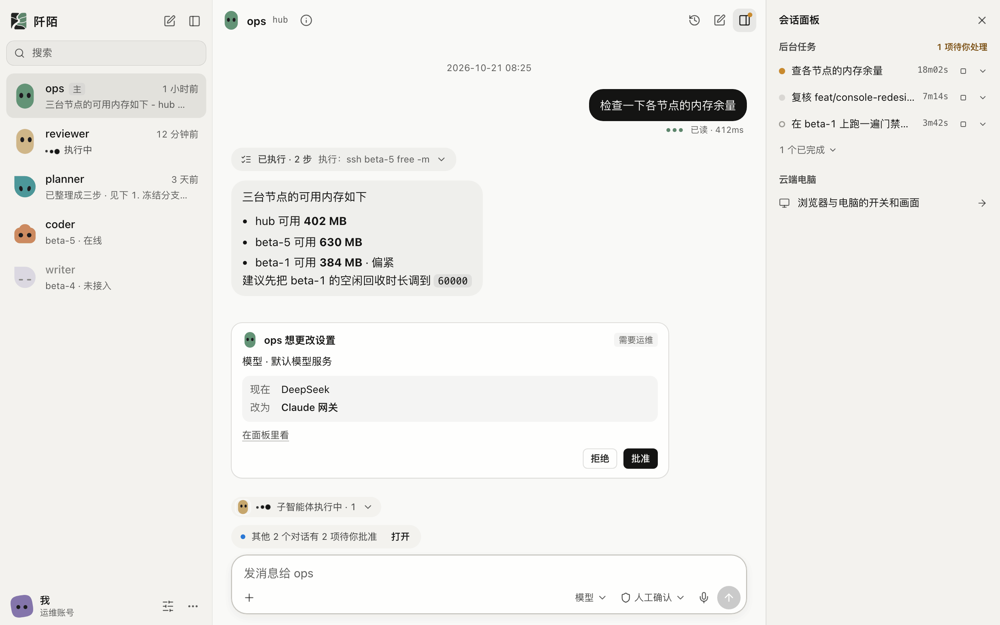
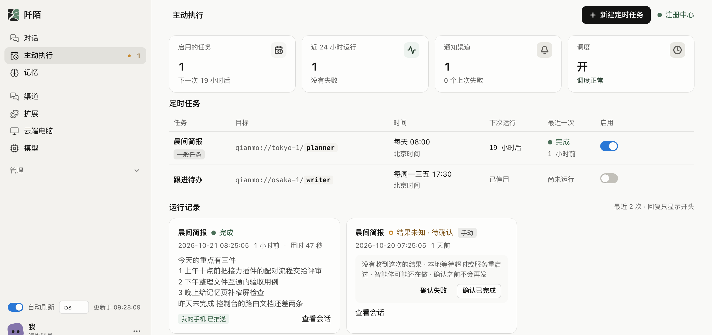
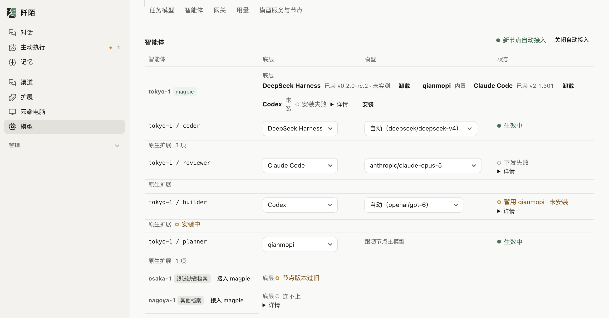
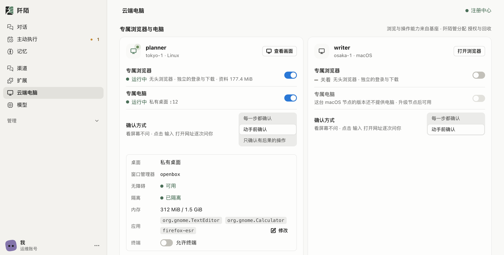
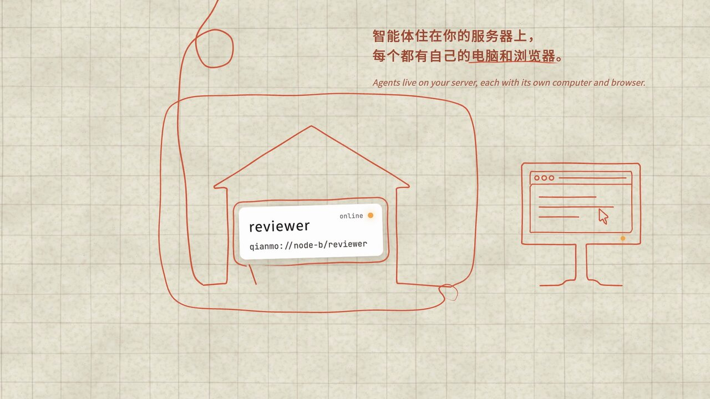
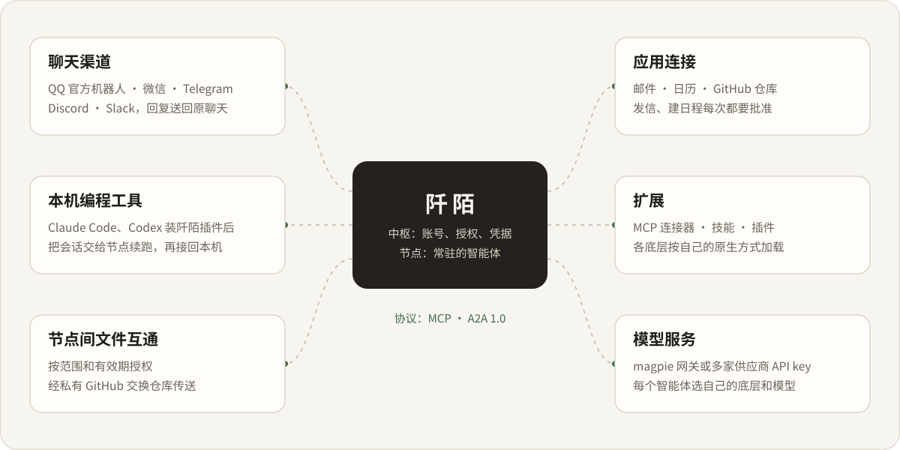
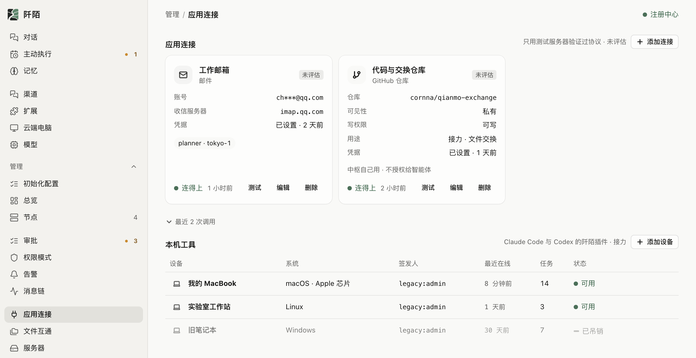
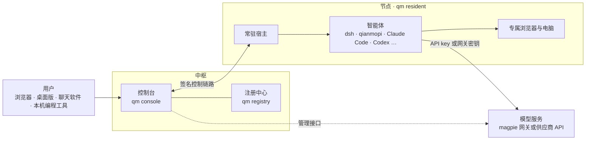

# 阡陌 Qmo

云端常驻智能体网络：智能体长期驻留在服务器上，带着记忆和自己的电脑，彼此按名寻址、协作，并接入用户已经在用的聊天工具和外部服务。

用户在网页控制台或聊天软件里把事情交给智能体。智能体在节点上常驻运行，会话和记忆都留在节点上；耗时的部分转成后台任务，做完回到原来的对话汇报。每个智能体可以选用不同的底层和模型，工具、权限与审计对所有底层一致。

项目处于内测阶段，公开版尚未开放。下文描述的是主线代码已经实现的能力，并不都在真实环境中验证过：尚未用真实账号或真实环境测过的主要部分随文注明，逐项的验证范围以[路线图](docs/dev/roadmap.md)为准。本仓库代号 atlas。

<p align="center">
  <a href="docs/assets/readme/qmo-film-720p.mp4?raw=true"></a>
  <br>
  <sub>宣传片，90 秒。点击封面下载 mp4（720p，约 7.7 MB），GitHub 页面里不能直接播放。</sub>
</p>

## 目录

- [能力](#能力)
- [架构](#架构)
- [快速开始](#快速开始)
- [开发与贡献](#开发与贡献)
- [文档](#文档)
- [安全](#安全)
- [来源与许可](#来源与许可)

## 能力

本节的控制台截图取自本地预览服务（[`atlas/packages/console/test/preview/`](atlas/packages/console/test/preview/README.md)），节点、智能体、对话和任务都是测试数据，不是真实部署的画面。

<p align="center">
  
  <br>
  <sub>对话前台：左侧是智能体，中间是对话，需要确认的动作以卡片形式出现，右侧是这段对话派出的后台任务。</sub>
</p>

### 能做到一切

- 智能体常驻在节点上：空闲时回收底层进程，来消息时唤醒，会话保存在节点上，进程退出后从原处续接。长期记忆按智能体和账号保存，可以在控制台查看和修改；语义检索增强没有通过质量闸门，默认关闭。
- 主对话只做短回答和调度。预计耗时的工作转成后台任务，派给自己的子会话或名册里的其他智能体；任务完成或需要补充信息时，结果回到原对话。任务也可以定时或按周期执行。
- 每个智能体选自己的底层和模型，同一节点上可以混用。默认底层是 DeepSeek Harness（dsh）；qianmopi 内置在 `qm` 里，其他底层不可用时自动退回它并写明原因；Claude Code、Codex、Gemini CLI、Qwen Code、opencode 按需安装。外部底层以官方发行版原样运行，只用 API key 或网关密钥，不用订阅登录。dsh 等经 ACP 接入的底层目前只在 macOS 上实测过。
- 所有底层拿到同一套宿主工具。智能体之间除了派任务，还可以经中枢同步提问（跨节点尚未做端到端实测）；换底层时，已有对话带着前情继续。
- 智能体可以读写控制台的全部设置，替人批准、账号与凭据、给智能体加权限、计费只能本人操作。主人在自己的对话里提出的请求就算批准，这一轮里的调用直接执行；定时任务、后台任务和别人的渠道对话里需要确认的动作，以卡片形式出现在对话里等人批准。智能体之间的消息不能替用户授权。
- 高权限模式分人工确认、自动接受编辑、自动审批、跳过权限确认四档，命令只在沙箱里执行，中枢开了 `--elevation` 才生效。消息与动作写入按节点保存的审计链，只增不改。

<table>
  <tr>
    <td width="50%"></td>
    <td width="50%"></td>
  </tr>
  <tr>
    <td><sub>主动执行：定时任务、运行记录和后台任务都在这一页。</sub></td>
    <td><sub>每个智能体选自己的底层和模型，同一节点上可以混用。</sub></td>
  </tr>
</table>

### 有自己的电脑和浏览器

- 每个智能体可以分到专属的浏览器和电脑，用点击、输入、拖拽、按键、截图这类动作操作网页和桌面程序。Linux 节点上每个智能体有自己的私有桌面会话，在沙箱里运行；macOS 上只开放运维列出的应用。
- 确认方式可选：默认每次操作都经一次性批准；自主模式下按后果分级，日常操作直接执行，删除、安装来路不明的软件、扩大权限这类操作先请主人批准，改凭据、付款这类操作交还给人。屏幕和网页上的文字不算授权，在页面里执行任意脚本保持禁用。
- 资源按智能体设内存上限，超限停用，回收时进程和目录一并清理；控制台「云端电脑」页能看到最近的截图。
- Claude Code、Codex 等外部底层经 MCP 使用同一套工具。
- 操作浏览器和电脑的能力来自基座 qianmopi，阡陌负责分配、授权、隔离、回收与审计。Linux 私有桌面在虚拟机上连续测过多轮；macOS 后台输入和内存超限停用还没有在真机上测过。

<table>
  <tr>
    <td width="55%"></td>
    <td width="45%"></td>
  </tr>
  <tr>
    <td><sub>云端电脑：按智能体开关专属浏览器和电脑，选确认方式，看隔离与内存。</sub></td>
    <td><sub>宣传片里的同一件事：每个智能体都有自己的电脑和浏览器。</sub></td>
  </tr>
</table>

### 能接入一切

- 客户端：除了浏览器，Windows 与 Linux 上有客户端 `qmo`，配对后一条命令打开前台；macOS 上有桌面版 Qmo，原生窗口里是对话界面 `/app` 与智能体界面 `/`，另有全局快捷键唤出的快速输入。桌面版只在 macOS 本机构建和运行过，v3.1.1 起在 GitHub 发行页附 macOS（Apple 芯片）的 `.dmg`，没有 Developer ID 签名与公证，Windows 与 Linux 还没有安装包；`qmo` 在 Windows 上只在 CI 里跑过。
- 桌面版的 Work 与 Code：主窗口分 Work 与 Code 两种模式，管理后台收成一张设置卡片，同一窗口可以分栏。Work 里每人跟每个智能体一条常驻会话，「开始一项工作」按演示文稿、文档、表格等六个工作流交给智能体，交付文件可以预览与下载。Code 里用这台电脑上用户自己登录的 Claude Code、Codex、Gemini CLI、Qwen Code、opencode、dsh 开本机会话，会话不经过中枢；单个会话可以打开 Remote，在同一账号的其他设备上续写；中枢连不上时也能打开本机会话。两种模式与设置卡片已部署到内测环境；本机会话、Remote、离线打开、Work 与分栏只在假进程、假模型与浏览器测试里验过，Qmo.app 里用真的 agent 还没有实测，v3.1.1 的 `.dmg` 里也没有它们。
- 聊天渠道：QQ（开放平台官方机器人）、微信、Telegram、Discord、Slack。消息进对应智能体的会话，回复送回原聊天；连接都由中枢拨出，不开入站端口。个人 QQ 经用户自己运行的 SnowLuma（OneBot 11）接入，SnowLuma 本身限非商用，公开版不提供这个渠道。各渠道都还没有用真实账号实测。
- 扩展：在控制台给智能体装 MCP 连接器、技能与插件，各底层按自己的原生方式加载，密钥由中枢封存。还没有用真实的 MCP 服务和插件仓库跑过整轮。
- 应用连接：邮件、日历与 GitHub 仓库。邮件与日历的凭据只留在中枢，节点上的智能体经中枢调用，发信、建日程每次都要批准；目前只对测试服务器验证过。
- 接力：本机的 Claude Code、Codex 装上阡陌插件、在控制台完成设备配对后，可以把当前编程会话交给节点续跑，再接回本机。代码经用户自己 GitHub 仓库的 `qianmo/*` 分支流转。跨机器接回和真实模型续跑尚未验证。
- 节点间文件互通：按范围和有效期授权，经私有 GitHub 交换仓库传送，中枢不留文件副本。目前以本机 git 远端代替 GitHub 验证过。
- 模型服务：控制台管理多家供应商的 API key（含套餐 key 与多 key 轮换），配置变更在节点空闲时热切换；也可以按任务给智能体匹配模型，这部分还没有在真实 key 上验证通过。接入 magpie 网关后，由网关统一管理上游、路由、故障转移与额度，「网关」页按底层系列给智能体配模型；magpie 只在少数上游组合上实测过。
- 协议：MCP 用于工具接入；`qm a2a` 提供 A2A 1.0 边界网关，支持单回合文本任务，已与官方 SDK 在本机互通。

接入外部系统一律走对方的官方接口和原生机制，阡陌只补身份、授权、隔离、调度、计量与审计。个人 QQ 是唯一的例外，依据见[章程](docs/dev/charter.md) §7.2。

<p align="center">
  
</p>

<p align="center">
  
  <br>
  <sub>应用连接：邮箱和 GitHub 仓库的凭据由中枢保管；下方是装了阡陌插件、可以接力的本机设备。</sub>
</p>

## 架构



- 中枢运行控制台与注册中心，管理账号与审批，保管模型服务、聊天渠道和应用连接的凭据，经签名控制链路指挥节点，节点经同一条链路回调中枢。中枢不转发模型流量。
- 节点由 `qm resident` 运行，把智能体挂在 `qianmo://<节点>/<智能体>` 地址下，为每个活跃会话起一个底层子进程，负责权限裁决、资源上限与审计。
- 控制台由 `qm console` 提供：前台 `/` 是与智能体的对话，`/app` 是桌面版用的对话界面，后台 `/admin` 管理节点、模型服务、网关、账号与审批、用量、渠道、扩展、记忆、定时任务、云端电脑和审计。页面在服务端渲染，没有前端构建步骤。
- 底层是智能体实际运行的 harness，每个智能体一种。qianmopi 是阡陌的基座，内置在 `qm` 里。
- 模型网关 magpie 是独立运行的开源网关，节点带各自的网关密钥直连它，中枢只调用它的管理接口。没有接网关时，节点按控制台下发的模型服务档案直连供应商。
- 注册中心提供按名发现，可以用共享 PostgreSQL 跑多实例。节点之间的消息有跳数、体积、存活时间与速率上限，防止智能体互相转发成环，上限定义在 `@qianmo/protocol` 的 `LIMITS` 里。

公开版是同一份代码的另一种部署形态：运营方托管，用户按节点订阅，订阅者用自己的模型 key 经平台 magpie 接入，闸门在服务端。公开版尚未开放，收款只对测试替身测过，见[公开版设计](docs/dev/public-edition.md)。

仓库布局：

| 路径 | 内容 |
| --- | --- |
| `atlas/` | 阡陌的 `@qianmo/*` 工作区包（`atlas/packages/`）、门禁脚本与测试 |
| `demo/` | 本地演示拓扑与验收脚本 |
| `docs/dev/` | 章程、路线图、设计与验收记录 |
| `packages/`、`crates/`、`scripts/`、`python/`、`sdk/`、`docs/*.md` | 基座 qianmopi 的源码树，保持上游布局 |

根 `package.json` 同时承载基座与阡陌的脚本，阡陌的脚本带 `atlas:`、`qianmo:` 前缀，另有 `qm`、`precheck`、`verify`。

## 快速开始

### 环境要求

- macOS 或 Linux。
- Bun，版本以 [`.tool-versions`](.tool-versions) 为准；运行一次性工具用 `bunx`。
- 构建原生插件需要 [`rust-toolchain.toml`](rust-toolchain.toml) 指定的 Rust nightly 与 ninja。
- 本地演示另需 git 与 Node.js。

### 安装与构建

```sh
git clone https://github.com/sweetcornna/atlas.git
cd atlas
bun install
bun run build:native    # 构建原生插件，节点智能体缺它起不来
bun run qm --help       # 源码模式运行 qm，入口 atlas/packages/node/src/cli.ts
```

`qm` 的状态都在配置根下，默认 `~/.qianmo`，用环境变量 `QIANMO_CONFIG_DIR` 改到别处；基座自己的状态在配置根的 `omp/` 子目录里。阡陌不读写 `~/.omp`、`~/.claude`、`~/.codex` 这些用户自己的目录。

### 本地演示

在一台机器上起一个注册中心和两个常驻节点，数据都放在仓库内的 `.demo-env/`，端口 38610 至 38612：

```sh
./demo/env/bootstrap.sh            # 前置检查、安装依赖、构建原生插件、自检
./demo/env/seed.sh                 # 演示目录、演示密钥、两个节点的工作区
./demo/env/up.sh                   # 起注册中心与两个节点，并做一次就绪探测
./demo/env/smoke.sh --with-task    # 按名解析、拨号、审计链自检，再发一条消息等回执
```

演示自检不需要模型凭据，验证的是寻址、拨号、消息回执与审计链；要让智能体完成真实回答，需要为节点配置模型服务，见[模型服务设计](docs/dev/providers-console-m1.md)。

拓扑起来后，在另一个终端里启动控制台：

```sh
QIANMO_CONFIG_DIR="$PWD/.demo-env/console" bun run qm console
```

控制台默认监听 127.0.0.1:38613，连本机 38610 端口的注册中心，`QIANMO_CONFIG_DIR` 把它的状态放进演示目录。启动后打印一行 `open` 地址，里面带着本次生成的访问令牌，用浏览器打开即可。用完运行 `./demo/env/down.sh` 停机，`./demo/env/reset.sh` 回到种子态。拓扑、端口与隔离规则见[演示环境](docs/dev/demo-env.md)，控制台的选项与鉴权见[控制台说明](docs/dev/console.md)。

## 开发与贡献

欢迎通过 issue 提问题和建议，通过 PR 提交改动。流程见 [CONTRIBUTING.md](CONTRIBUTING.md)，开发约定见 [CLAUDE.md](CLAUDE.md) 与 [CLAUDE.full.md](CLAUDE.full.md)。

```sh
bun run precheck                  # 改代码后：biome 修复、类型检查、路径与版权头门禁、阡陌测试
bun run verify                    # 推送或发 PR 前：只读的全量门禁
bun run atlas:test atlas/scripts  # 只跑指定目录的阡陌测试分片
bun test --preload ./atlas/tests/preload.ts ./atlas/packages/<包>/test/<名>.test.ts
```

- `precheck` 会改写 `atlas/`、`demo/` 下的格式，跑完检查 diff。只改文档时核对链接并运行 `git diff --check`。
- 版权头与路径门禁依赖 `base-snapshot/*` 标签，浅克隆先补拉：`git fetch --depth 1 origin 'refs/tags/base-snapshot/*:refs/tags/base-snapshot/*'`。
- 提交信息用 Conventional Commits，一个提交一件事。所有改动经 PR 与评审合入 `main`，不直接推送。
- 优先使用基座的扩展点。确实要改基座路径下的文件时，在同一个 PR 里登记到[基座改动清单](docs/dev/base-modifications.md)。
- 本仓库不发布 npm 包，也不运行基座的发布流程。

## 文档

| 文档 | 内容 |
| --- | --- |
| [章程](docs/dev/charter.md) | 范围、非目标、工程与法律边界、对外表述 |
| [路线图](docs/dev/roadmap.md) | 排期与各任务包的状态 |
| [开发与验收清单](docs/dev/m1-m2-completion.md) | M1、M2 的逐项实现与验证 |
| [部署审核清单](docs/dev/m1-m2-deployment-review.md) | 部署配置、现场验证与回退 |
| [基座接入契约](docs/dev/base-switch-omp.md) | 基座的接入方式、状态布局与上游同步 |
| [消息协议](docs/dev/protocol.md) | 地址、信封、上限与错误码 |
| [控制台](docs/dev/console.md) | `qm console` 的选项、鉴权与页面 |
| [多底层目录](docs/dev/harness-backends.md) | 底层目录、默认 dsh、底层互通 |
| [多底层、聊天渠道与前台调度](docs/dev/runtimes-channels.md) | 渠道、后台任务、专属电脑、扩展 |
| [新方向设计](docs/dev/directions-2026-10.md) | 接力插件、文件互通、云端电脑、记忆、主动执行、应用连接 |
| [模型网关](docs/dev/magpie-gateway.md) | magpie 接入与「网关」页 |
| [公开版](docs/dev/public-edition.md) | 订阅制部署形态 |
| [智能体改设置](docs/dev/agent-settings.md) | 设置目录、改设置工具与确认 |
| [客户端](docs/dev/clients.md) | Windows 与 Linux 客户端 `qmo` |
| [桌面版](docs/dev/qmo-app.md) | Tauri 壳、对话界面与快速输入、分栏 |
| [本机开发](docs/dev/qmo-local.md) | Work 与 Code 两种模式、本机会话、Remote、离线打开 Code |
| [Work](docs/dev/work-tasks.md) | 常驻会话与「开始一项工作」 |
| [接力接法](docs/dev/handoff-usage.md) | 本机编程工具与节点的配对和接力 |
| [演示环境](docs/dev/demo-env.md) | 本地演示拓扑 |
| [基座改动清单](docs/dev/base-modifications.md) | 对基座文件的修改与删除登记 |
| [v3.2.1 发行说明](docs/dev/release-v3.2.1.md) | 最近一次 GitHub 发行：修 v3.2.0 源码构建不了 `qm` 等三处 |
| [v3.2.0 发行说明](docs/dev/release-v3.2.0.md) | Work 与 Code 两种模式、本机会话、Remote、分栏、基座同步到上游 v18.14.1，改动、部署与已知问题 |
| [v3.1.1 发行说明](docs/dev/release-v3.1.1.md) | 桌面版 macOS 安装包与壳的许可声明 |
| [v3.1.0 发行说明](docs/dev/release-v3.1.0.md) | v3.1.0 的改动、部署与已知问题 |

## 安全

安全问题请经 GitHub Security Advisories 私下报告，不要开公开 issue，流程见 [SECURITY.md](SECURITY.md)。本仓库没有经过第三方安全审计，常驻节点与控制台不建议部署在生产环境或承载敏感数据。

## 来源与许可

阡陌基于开源项目 oh-my-pi（MIT 许可）构建，在其上实现常驻化改造与智能体通信网络。本仓库把这个基座称为 qianmopi，以零改动快照导入仓库根目录，当前快照由 [`atlas/upstream/omp.json`](atlas/upstream/omp.json) 指定，溯源以 [BASE.md](BASE.md) 为准。编程智能体与多模型适配是基座原有的能力，阡陌新增的是常驻化改造、智能体通信网络和其上的应用场景。2026-08-11 至 2026-10-07 这一阶段基于 open-claude-code，相关记录保留在提交历史和 [NOTICE](NOTICE) 中。

本仓库双许可，分界按路径判定：路径存在于当前基座快照里的文件属于基座层，其余属于阡陌层。

- 阡陌自有代码适用 [AGPL-3.0-or-later](LICENSE)，包括 `atlas/`、`demo/`、`docs/dev/` 与阡陌撰写的其他文档。阡陌新增的文件带 `SPDX-License-Identifier: AGPL-3.0-or-later` 文件头，JSON、图片等带不了注释的格式除外。
- 由基座导入的代码适用 MIT，许可正文是上游 `LICENSE` 的逐字副本，见 [LICENSE.base](LICENSE.base)，上游版权声明一并保留。
- 阡陌改动过的基座文件不加文件头，逐条登记在[基座改动清单](docs/dev/base-modifications.md)，各自适用的许可在 NOTICE 一.4 逐类说明。本文件的路径来自基座，内容全部由阡陌撰写，属于阡陌作品。
- `docs/assets/` 下的图片、宣传片与申报材料另有许可规则；宣传片配乐所用第三方录音的署名列在 NOTICE 五.9。

用户通过网络与本程序交互时（控制台与常驻节点都属于这种情况），运营方须向用户提供对应源代码，依据是 AGPL-3.0 第 13 条，见 NOTICE 一.6。文件归属判据、非代码资产的许可与商标说明以 [NOTICE](NOTICE) 为准。文中提到的 DeepSeek、Claude Code、Codex、Gemini 等名称归各自的权利人所有，属于指称性使用；本项目与 DeepSeek、Anthropic、OpenAI、Google、Stencil Labs 及 Pi 的作者无关联，未获其背书。
